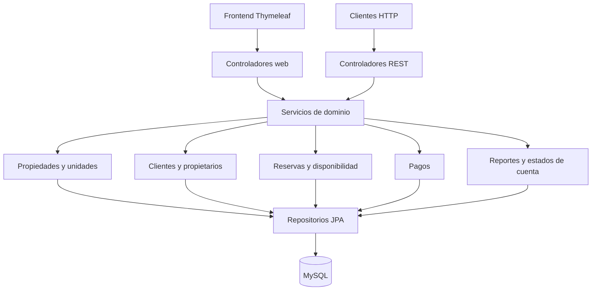

# Arquitectura basada en servicios

Aplicación Spring Boot con interfaz Thymeleaf, controladores REST, servicios de dominio y persistencia JPA en MySQL. Se despliega como un monolito con capa de servicios.

| Requisito | Servicios |
| --- | --- |
| Casas/pisos y habitaciones con características | PropiedadService, UnidadRentableService |
| Arrendatarios y propietarios | ClienteService |
| Disponibilidad y reservas | DisponibilidadService, ReservaService |
| Pagos y estados de cuenta | PagosService, ReporteService |
| Ocupación, ingresos y morosidad | ReporteService |

## Reglas

Las reservas cargan la unidad y cliente registrados, validan estados, bloqueos y solapamientos. Un bloqueo de fila protege las reservas simultáneas de la misma unidad. El importe automático usa noches de calendario y el precio de la unidad.

Los pagos se vinculan a la reserva; su cliente se deriva de ella. Una confirmación genera fecha de cobro, un reembolso devuelve el saldo pendiente. Los pagos confirmados o reembolsados no se eliminan desde PagosService.

Los periodos de reportes incluyen desde y excluyen hasta. Ocupación = noches de reservas CONFIRMADA/CHECKIN/CHECKOUT / noches del inventario actual. Los pendientes, cancelados o rechazados no cuentan como ocupación. Los ingresos se calculan con pagos actualmente PAGADO por fecha de cobro.

El estado de cuenta suma cargos de reservas activas menos pagos confirmados. Morosidad = cargos pendientes cuyo vencimiento ya pasó; el importe de reserva sin calendario vence tras la fecha de entrada. Se limita al saldo pendiente. Los reembolsos no reducen saldo. La fecha de corte usa estados actuales y fechas; no reconstruye históricos anteriores a cancelaciones o reembolsos.

## Rutas

- /reportes
- /api/reportes/ocupacion?desde=2026-10-01&hasta=2026-11-01
- /api/reportes/ingresos?desde=2026-10-01&hasta=2026-11-01
- /api/reportes/morosidad
- /api/clientes/1/estado-cuenta

Ver README.md para instalación y docs/REVISION_FINAL.md para el resultado final: 28 pruebas aprobadas, esquema MySQL validado y JAR ejecutado correctamente.
